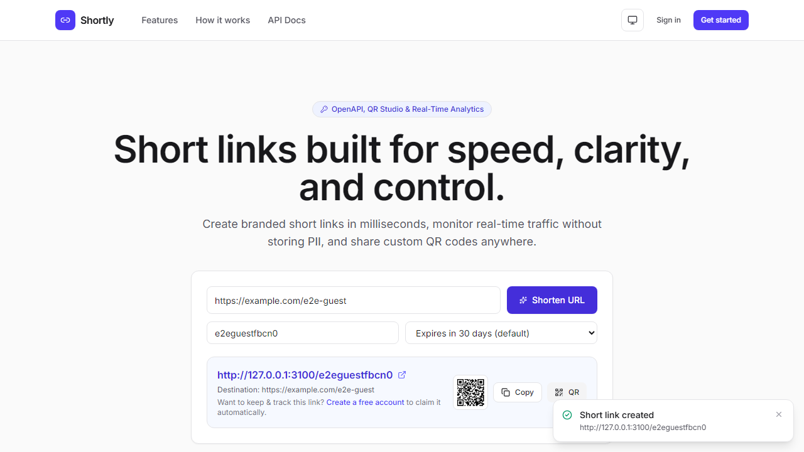
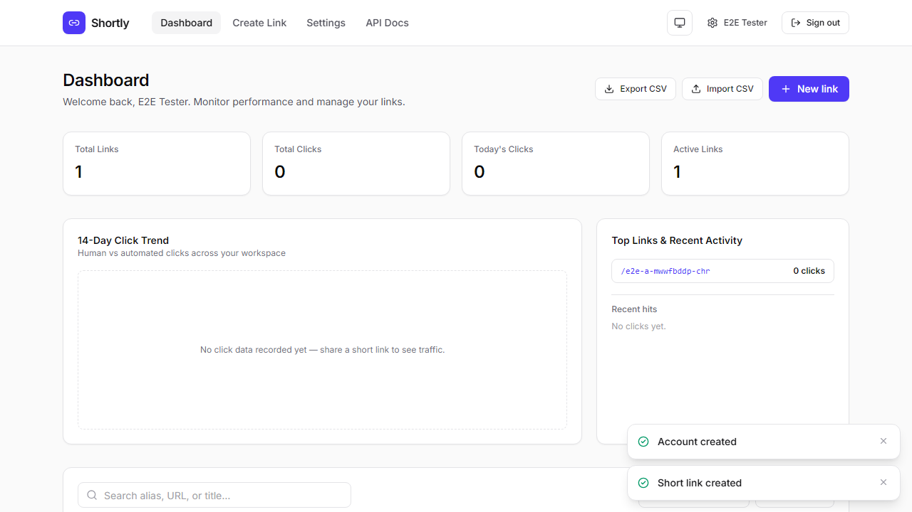
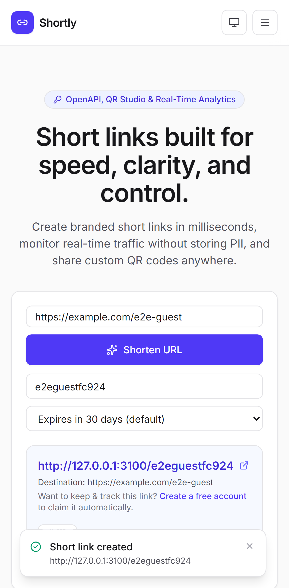
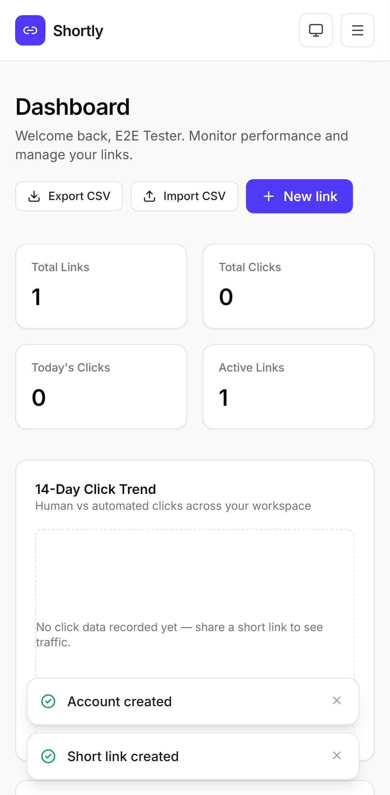
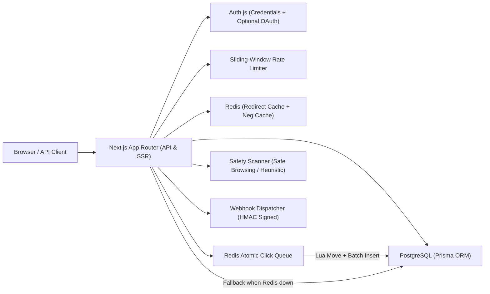

# Shortly — Production-Grade URL Shortener & Analytics Platform

**Shortly** is a full-stack URL shortening, smart routing, branded QR studio, and privacy-first analytics platform built with Next.js (App Router), TypeScript (`strict: true`), PostgreSQL (Prisma), and Redis.

**Author:** Lokesh Reddy ([lokeshreddygoli2005@gmail.com](mailto:lokeshreddygoli2005@gmail.com))

---

## Live Demo

No public hosted demo URL is provisioned in this repository workspace. You can run the complete production stack locally with realistic seeded data (`demo@shortly.dev` / `DemoPass123!`, including sample links, A/B variants, click history, and UTM presets):

- **Option A — Docker Compose (PostgreSQL 17 + Redis 7 + Next.js standalone):**
  ```bash
  cp .env.example .env
  docker compose up --build -d
  docker compose exec app npm run db:seed:demo
  ```
  Then open `http://localhost:3000`.

- **Option B — Local Node.js without Docker Daemon (embedded PostgreSQL 17.12):**
  ```bash
  cp .env.example .env
  npm install
  npm run db:local        # boots local PostgreSQL 17.12 on localhost:5432 (shortly + shortly_test)
  npx prisma migrate deploy
  npm run db:seed:demo    # seeds demo@shortly.dev / DemoPass123!
  npm run build && npm run start
  ```

See [DEPLOYMENT_GUIDE.md](DEPLOYMENT_GUIDE.md) for production hosting on VPS (Docker Compose + TLS proxy) or managed PaaS (Vercel + Neon + Upstash).

---

## Screenshots

Captured from live Playwright verification across desktop (`1280×720`) and mobile (`Pixel 7`) viewports:

| Desktop Landing (`1280×720`) | Desktop Dashboard (`1280×720`) |
|---|---|
|  |  |

| Mobile Landing (`Pixel 7`) | Mobile Dashboard (`Pixel 7`) |
|---|---|
|  |  |

---

## Key Features

- **Fast, Reliable Redirect Engine (`GET /:code`)**:
  - `302 Found` default with `Cache-Control: no-store` for accurate analytics (plus `307` and opt-in `301`).
  - Redis cache-aside with explicit invalidation on edits/deletes and 15s negative caching for `404`s.
  - Atomic Redis click queue (`Lua` `LPOP`→`RPUSH` into processing list + idempotent `ClickEvent.id` `ON CONFLICT DO NOTHING` batch persistence), falling back automatically to direct asynchronous DB writes when Redis is unavailable.
  - Separate bot/link-preview crawler detection and dedicated `404` / `410` / `429` pages.
- **Hardened Shortening & Security**:
  - Cryptographic 7-character Base62 codes (`crypto.randomInt`) and case-insensitive custom aliases (`3-32` chars) with reserved-word protection.
  - SSRF & safety guardrails (blocks `javascript:`, `data:`, `file:`, credentials-in-URL, loopback/private/link-local IPv4 & IPv6, hex/octal/decimal IP encodings, and own-domain redirect loops), re-checked at redirect time and during preview fetches.
  - Shared Redis sliding-window rate limiting (with in-memory fallback when Redis is offline), CSP & security headers, CSRF origin checks, `bcryptjs` hashing, and 5-attempt login lockout.
  - Fail-closed secret validation in production (`AUTH_SECRET`, `ANALYTICS_HASH_SECRET`, `GUEST_CLAIM_SECRET` ≥ 32 chars).
- **Privacy-First Analytics**:
  - Raw IPs are never persisted; unique visitor metrics use a daily-rotating HMAC-SHA256 hash (`ANALYTICS_HASH_SECRET`).
  - Time-series charts, referrers, device/browser/OS, geo headers, UTM breakdown, 7×24 peak hours heatmap, CSV export, and live Server-Sent Events (SSE) stream.
- **Advanced Capabilities**:
  - Password-protected links, click limits, and scheduled expiration (`link.expired` webhook event).
  - Smart routing (`DEVICE`, `COUNTRY`, `TIME_WINDOW`) and weighted `AB_SPLIT` testing with per-variant analytics.
  - Branded QR Code Studio (PNG & SVG export with `?qr=1` scan attribution).
  - Scoped Bearer API keys (`links:read`, `links:write`, `analytics:read`, enforced per route + per-key rate limits), OpenAPI 3.0.3 spec (`/api/openapi.json`) & interactive `/docs`, HMAC-SHA256 signed webhooks with retries, CSV bulk import/export, `⌘K` command palette, dynamic-origin bookmarklet, and role-gated `/admin` console.

---

## Architecture & Documentation



- [System Architecture](docs/ARCHITECTURE.md)
- [Threat Model & Security Practices](docs/SECURITY.md)
- [Architecture Decision Records (ADRs)](docs/adrs/)
- [Independent Audit Findings & Fixes](FINAL_AUDIT.md)
- [Verification & Test Report](FINAL_TEST_REPORT.md)
- [Security Audit Report](SECURITY_AUDIT.md)
- [Performance & Reliability Report](PERFORMANCE_REPORT.md)
- [Production Deployment Guide](DEPLOYMENT_GUIDE.md)
- [Build Progress Log](PROGRESS.md)
- [Engineering & Interview Notes](INTERVIEW_NOTES.md)

---

## Tech Stack

- **Frontend / App:** Next.js `16.4.6` (App Router, Turbopack), React `19.3.1`, TypeScript (`strict: true`), Tailwind CSS v4, Lucide Icons, Recharts, Framer Motion
- **Database:** PostgreSQL 17 + Prisma `6.19.3`
- **Cache / Queue / Rate Limit:** Redis (`ioredis` `6.1.0`) with automatic in-memory / direct-DB fallback
- **Auth:** Auth.js (`next-auth` `5.0.0-beta.32`) with Credentials (`bcryptjs`) + optional Google OAuth
- **Validation & Logging:** Zod `4.6.7`, Pino `10.4.0` structured JSON logging
- **Testing & Load:** Vitest `3.2.7`, Playwright `1.65.1` + `@axe-core/playwright`, k6 `v2.4.0`

---

## Environment Variables

See [.env.example](.env.example) for the complete template.

| Variable | Required | Description |
|---|---|---|
| `DATABASE_URL` | Yes | PostgreSQL connection string for runtime and migrations |
| `TEST_DATABASE_URL` | No | Separate PostgreSQL database for Vitest integration tests |
| `REDIS_URL` | No | Redis URL for cache-aside, rate limits, and click queue (degrades gracefully if unset/down) |
| `AUTH_SECRET` | Yes | ≥ 32-char secret for Auth.js JWTs and gate cookies (required in production) |
| `ANALYTICS_HASH_SECRET` | Yes | ≥ 32-char secret for daily-rotating visitor hashes (required in production) |
| `GUEST_CLAIM_SECRET` | Yes | ≥ 32-char secret for signing guest link claim tokens (required in production) |
| `APP_URL` | Yes | Canonical base URL (e.g. `https://short.ly`) |
| `NEXTAUTH_URL` | No | Auth.js canonical URL (set equal to `APP_URL` in production) |
| `GOOGLE_CLIENT_ID` / `SECRET` | No | Enables Google OAuth sign-in when both are set |
| `EMAIL_PROVIDER` | No | `console` (default dev logger) or `smtp` |
| `GOOGLE_SAFE_BROWSING_API_KEY` | No | Enables Google Safe Browsing v4 checks alongside local heuristics |
| `REDIRECT_RATE_LIMIT` | No | Overrides default per-IP redirect limit (`600`/min) |

---

## Available Scripts

| Script | Description |
|---|---|
| `npm run dev` | Start Next.js development server |
| `npm run build` | Build Next.js production bundle (`standalone` output) |
| `npm run start` | Start built production server |
| `npm run lint` | Run ESLint (`eslint .`) |
| `npm run typecheck` | Run TypeScript strict typecheck (`tsc --noEmit`) |
| `npm test` | Run Vitest unit + PostgreSQL integration suite |
| `npm run test:coverage` | Run Vitest with V8 coverage report |
| `npm run test:e2e` | Run Playwright E2E + axe accessibility suite |
| `npm run db:local` | Start embedded PostgreSQL 17.12 locally |
| `npm run db:generate` | Generate Prisma Client |
| `npm run db:migrate` | Run `prisma migrate dev` |
| `npm run db:migrate:deploy` | Apply production Prisma migrations |
| `npm run db:seed` / `db:seed:demo` | Seed baseline / demo database records |

---

## Benchmarks (Methodology and Limits)

### 1. Redirect & API Load Benchmarks (`k6 v2.4.0`)

Measured against production `next start` (`127.0.0.1`) with [redirect-benchmark.k6.js](tests/load/redirect-benchmark.k6.js) (25 concurrent VUs: 20 `redirects` VUs hitting seeded link `launch-26` + 5 `creates` VUs calling `POST /api/urls`, 15s duration). To measure redirect engine throughput rather than single-IP loopback throttling, `REDIRECT_RATE_LIMIT=100000` was set during the benchmark; guest `creates` intentionally hit the `15/min` per-IP limit (`429`) and are marked as expected responses alongside `201`.

| Configuration | Redirect Avg | Redirect p50 | Redirect p95 | Redirect p99 | Mixed Throughput | HTTP Error Rate |
|---|---|---|---|---|---|---|
| PostgreSQL Direct (`REDIS_URL=""`) | 82.16 ms | 80.13 ms | 106.52 ms | 126.28 ms | 38.73 req/s (1,743 reqs) | 0.00% |
| **Redis Cache-Aside + Click Queue** | **30.95 ms** | **27.95 ms** | **52.50 ms** | **78.68 ms** | **87.58 req/s (3,941 reqs)** | **0.00%** |

### 2. PostgreSQL Query Plan Verification (`EXPLAIN ANALYZE`)

Verified via [check-explain.mjs](scripts/check-explain.mjs) with `enable_seqscan = off`:
- `ShortUrl` code lookup: `Index Scan using "ShortUrl_normalizedCode_key"` (`0.456 ms` execution)
- `ClickEvent` analytics aggregation: `Index Scan using "ClickEvent_shortUrlId_visitorHash_idx"` (`0.102 ms` execution)
- `DailyLinkStats` rollup read: `Index Scan Backward using "DailyLinkStats_shortUrlId_day_key"` (`0.058 ms` execution)

### 3. Lighthouse Web Performance (`/` · `/login` · `/dashboard`)

Measured against `next start` using Chrome/Lighthouse in both Desktop (`40ms RTT`, `10 Mbps`, `1x` CPU) and Mobile (`150ms RTT`, `1.6 Mbps`, `4x` CPU) emulation:

| Route | Desktop (Perf / A11y / BP / SEO) | Mobile (Perf / A11y / BP / SEO) | Desktop LCP / TBT | Mobile LCP / TBT |
|---|---|---|---|---|
| `/` | 100 / 100 / 100 / 100 | 100 / 100 / 100 / 100 | 0.6 s / 10 ms | 0.8 s / 80 ms |
| `/login` | 100 / 100 / 100 / 100 | 100 / 100 / 100 / 100 | 0.2 s / 0 ms | 0.7 s / 30 ms |
| `/dashboard` | 100 / 100 / 100 / 100 | 100 / 100 / 100 / 100 | 0.3 s / 0 ms | 0.9 s / 40 ms |

### Measurement Limits
- Benchmarks ran on a single Windows host (`Node.js v22.14.0`, `embedded-postgres` 17.12, local Redis 3.0.504), so loopback network RTT is near zero (~0.4 ms) and CPU contention is shared across load generator, app server, Redis, and PostgreSQL.
- Docker Compose container execution (`docker compose up --build`) could not be run on this host because the Docker daemon is not running (`//./pipe/docker_engine` unavailable).
- Results validate relative architectural speedup (`2.65×` lower average redirect latency and `2.26×` higher mixed RPS with Redis enabled) rather than multi-region production capacity.

See [PERFORMANCE_REPORT.md](PERFORMANCE_REPORT.md) for raw command outputs and failure-mode measurements.
