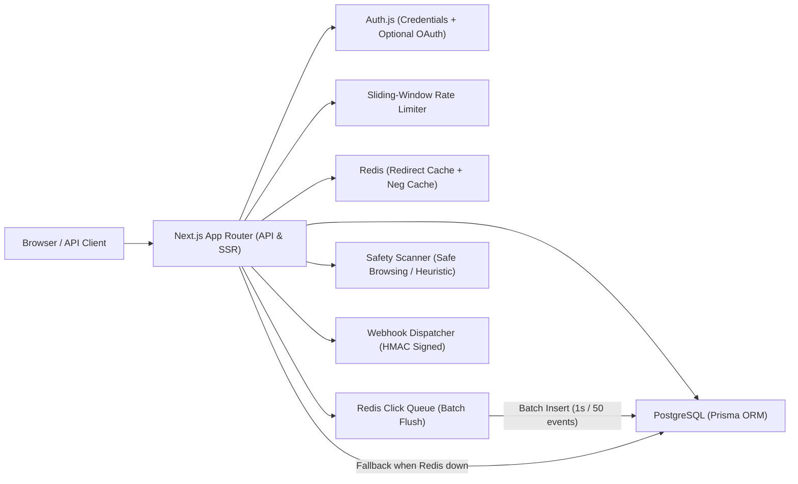

# Shortly — Production-Grade URL Shortener & Analytics Platform

**Shortly** is a full-stack URL shortening, smart routing, QR studio, and privacy-first analytics platform built with Next.js (App Router), TypeScript, PostgreSQL (Prisma), and Redis.

---

## Key Features

- **Fast, Correct Redirect Engine (`GET /:code`)**:
  - `302 Found` default with `Cache-Control: no-store` for accurate analytics (plus `307` and opt-in `301`).
  - Redis cache-aside with explicit invalidation on edits/deletes and 15s negative caching for 404s.
  - Non-blocking click ingestion via Redis list queue + batch DB inserts (gracefully falls back to direct async DB inserts when Redis is offline).
  - Separate bot/link-preview crawler detection and proper `404` / `410` / `429` pages.
- **Hardened Shortening & Security**:
  - Cryptographic 7-character Base62 codes (`crypto.randomInt`) and case-insensitive custom aliases (`3-32` chars) with reserved-word protection.
  - Adversarial SSRF guard (blocks `javascript:`, `data:`, `file:`, credentials-in-URL, loopback/private/link-local IPv4 & IPv6, decimal/hex IP tricks, and own-domain redirect loops), re-checked at redirect time.
  - Sliding-window rate limiting (`429` + `Retry-After` + `X-RateLimit-*`), CSP & security headers, CSRF origin checks, bcrypt password hashing, and 5-attempt login lockout.
- **Privacy-First Analytics**:
  - Raw IPs are never stored; unique visitor metrics use a daily-rotating HMAC-SHA256 hash.
  - Time-series charts, referrers, device/browser/OS, geo headers, UTM breakdown, 7×24 peak hours heatmap, and live Server-Sent Events (SSE) stream.
- **Advanced Capabilities**:
  - Password-protected links, click limits, and scheduled expiration.
  - Smart routing (device, country, time-window) and weighted A/B split testing.
  - Branded QR Code Studio (PNG & SVG export with `?qr=1` scan attribution).
  - Scoped Bearer API keys, OpenAPI 3.0.3 spec (`/api/openapi.json`) & interactive `/docs`, HMAC-SHA256 signed webhooks with retries, CSV bulk import/export, `⌘K` command palette, bookmarklet, and role-gated `/admin` console.

---

## Architecture



See [ARCHITECTURE.md](docs/ARCHITECTURE.md), [SECURITY.md](docs/SECURITY.md), and [ADRs](docs/adrs/) for deep dives.

---

## Tech Stack

- **Frontend / App:** Next.js 16.4.6 (App Router, Turbopack), React 19, TypeScript (`strict: true`), Tailwind CSS v4, Lucide Icons, Recharts
- **Database:** PostgreSQL 17 + Prisma 6.19.3
- **Cache / Queue / Rate Limit:** Redis (`ioredis`) with automatic in-memory / direct-DB fallback
- **Auth:** Auth.js (`next-auth@5.0.0-beta.32`) with Credentials + optional Google OAuth
- **Validation & Logging:** Zod 4, Pino structured JSON logging
- **Testing & Load:** Vitest, Playwright + `@axe-core/playwright`, k6

---

## Quick Start (3 Commands)

```bash
cp .env.example .env
npm install
docker compose up --build
```

### Local Development without Docker Daemon
If Docker Desktop is not running locally, you can boot a user-space PostgreSQL 17.12 instance directly via `embedded-postgres`:

```bash
npm run db:local        # starts local PostgreSQL on localhost:5432 (shortly + shortly_test)
npx prisma migrate dev  # applies database migrations
npm run db:seed:demo    # optional: seeds demo@shortly.dev / DemoPass123!
npm run dev             # starts Next.js dev server on http://localhost:3000
```

---

## Environment Variables

| Variable | Required | Description |
|---|---|---|
| `DATABASE_URL` | Yes | PostgreSQL connection string for runtime and migrations |
| `TEST_DATABASE_URL` | No | Separate PostgreSQL database for integration tests |
| `REDIS_URL` | No | Redis URL for cache-aside, rate limits, and click queue (degrades gracefully if unset/down) |
| `AUTH_SECRET` | Yes | ≥ 32-char secret for Auth.js JWTs and gate cookies |
| `ANALYTICS_HASH_SECRET` | Yes | ≥ 32-char secret for daily-rotating visitor hashes |
| `GUEST_CLAIM_SECRET` | Yes | ≥ 32-char secret for signing guest link claim tokens |
| `APP_URL` | Yes | Canonical base URL (e.g. `https://short.ly`) |
| `GOOGLE_CLIENT_ID` / `SECRET` | No | Enables Google OAuth sign-in when both are set |
| `EMAIL_PROVIDER` | No | `console` (default dev logger) or `smtp` |
| `GOOGLE_SAFE_BROWSING_API_KEY` | No | Enables Google Safe Browsing v4 checks alongside local heuristics |

---

## Available Scripts

| Script | Description |
|---|---|
| `npm run dev` | Start development server |
| `npm run build` | Production Next.js build (`standalone` output) |
| `npm run lint` | Run ESLint |
| `npm run typecheck` | Run TypeScript strict typecheck |
| `npm test` | Run Vitest unit + PostgreSQL integration suite |
| `npm run test:coverage` | Run Vitest with V8 coverage report |
| `npm run test:e2e` | Run Playwright E2E + axe accessibility suite |
| `npm run db:local` | Start embedded PostgreSQL 17.12 locally |
| `npm run db:seed:demo` | Seed realistic demo data (`demo@shortly.dev` / `DemoPass123!`) |

---

## Load Test Results (`k6`)

Measured locally with `k6 v2.4.0` (`tests/load/redirect-benchmark.k6.js`, 25 concurrent VUs: 20 redirect VUs + 5 link-creation VUs for 15s) against `next start`:

| Configuration | Redirect Avg | Redirect p50 | Redirect p95 | Mixed Throughput | Error Rate |
|---|---|---|---|---|---|
| PostgreSQL Direct (Redis Off) | 67.89 ms | 64.68 ms | 90.05 ms | 60.1 req/s | 0.00% |
| **Redis Cache-Aside + Click Queue** | **27.93 ms** | **26.27 ms** | **43.21 ms** | **105.2 req/s** | **0.00%** |

---

## API Overview

Full OpenAPI 3.0.3 schema is served at `GET /api/openapi.json` and browsable at `/docs`.

- `POST /api/urls` / `GET /api/urls` — Create and list/search/filter links
- `GET/PATCH/DELETE /api/urls/:id` — Manage single link
- `GET /api/urls/:id/analytics` & `GET /api/urls/:id/stream` — Aggregated analytics & live SSE click feed
- `GET /api/urls/:id/qr` — Branded PNG & SVG QR generation
- `POST /api/urls/bulk`, `POST /api/urls/import`, `GET /api/urls/export` — Bulk operations & CSV/JSON tools
- `GET/POST/DELETE /api/keys` & `/api/webhooks` — Developer API keys & HMAC webhooks
- `GET /api/health` & `GET /api/ready` — Liveness & dependency readiness probes

---

## Deployment

- **Docker Compose (VPS / VM):** Set strong secrets in `.env` and run `docker compose up -d --build`. Migrations apply automatically on container boot via `npx prisma migrate deploy`.
- **Managed PaaS (Vercel + Neon Postgres + Upstash Redis):** Connect repository, configure `DATABASE_URL`, `REDIS_URL`, `AUTH_SECRET`, `ANALYTICS_HASH_SECRET`, `GUEST_CLAIM_SECRET`, `APP_URL`, and run `npx prisma migrate deploy` in the build/release step.
