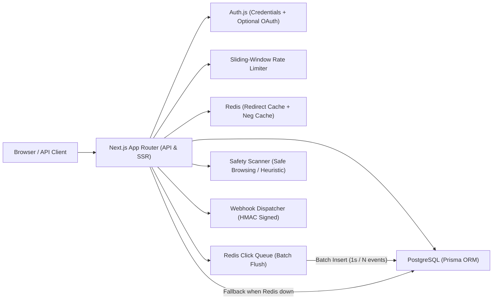

# Shortly — System Architecture

## 1. Overview

**Shortly** is a layered, production-grade URL shortening and analytics platform built on Next.js (App Router), PostgreSQL (Prisma), and Redis (ioredis).

```
Route Handler / Server Action (HTTP validation, auth context, envelope)
        │
        ▼
Service Layer (business rules, SSRF checks, code generation, authorization)
        │
        ▼
Repository / Cache / Queue Layer (Prisma + PostgreSQL, Redis cache-aside & queue)
```

## 2. System Diagram



## 3. Core Request Flows

### A. Create Short Link (`POST /api/urls`)
1. Parse JSON body with size limit and validate with Zod (`url`, optional `alias`, `expiresAt`, `clickLimit`, `password`, `redirectType`, `utm`, `rules`).
2. Enforce rate limit (stricter for guests vs authenticated users vs API keys).
3. Normalize and validate URL (`http:`/`https:` only, punycode/IDN host normalization, reject credentials-in-URL, loopback/private/link-local IP ranges, and own domain).
4. Run safety check (heuristic + optional Google Safe Browsing).
5. If `alias` provided: validate `[a-zA-Z0-9-_]`, 3–32 chars, reserved word check, case-insensitive uniqueness check (`409 ALIAS_TAKEN` on collision).
6. Else: generate 7-char Base62 code with `crypto.randomInt`, retry up to 5 times on unique-constraint collision.
7. Persist `ShortUrl` (and optional `LinkRule` variants) in PostgreSQL; return `201` with consistent JSON envelope.

### B. Redirect Engine (`GET /:code`)
1. Cheap format check on `:code` (`^[a-zA-Z0-9_-]{3,32}$`) before touching Redis or DB.
2. Check Redis cache (`link:<normalizedCode>`); if hit on negative cache (`404`), return 404 immediately.
3. On cache miss, query PostgreSQL by indexed normalized `code`, populate Redis cache (short TTL, e.g., 60s) or negative cache (e.g., 15s for 404).
4. Evaluate state: exists -> active -> not expired -> click limit not reached -> safety interstitial check -> password gate check -> smart routing rules (device/country/time/A-B split).
5. Re-validate destination safety at redirect time.
6. Emit click event non-blocking (enqueue to Redis list/stream; fall back to asynchronous direct DB insert if Redis is unavailable). Never block the HTTP redirect response on analytics persistence.
7. Return `302 Found` (default, `Cache-Control: no-store`), `307`, or opt-in `301`.

### C. Analytics Write & Read
- **Write:** Worker/flusher drains click events from Redis in batches (e.g., every 1s or 100 events) into `ClickEvent` and increments `DailyLinkStats` rollups. On `SIGTERM`/`SIGINT`, flush remaining buffered events before exit.
- **Privacy:** IP addresses are never stored. Instead, a daily-rotating salt (`HMAC-SHA256(dailySalt, ip + ua)`) computes `visitorHash` for unique visitor counts.
- **Read:** Indexed SQL aggregations (`shortUrlId, clickedAt`) and `DailyLinkStats` rollups return overview, timeseries, geo, device/browser/OS, referrer, UTM, and day×hour heatmap metrics, distinguishing `null` (no data) from `0`.

## 4. Failure Modes & Graceful Degradation

| Dependency Failure | Behavior |
|---|---|
| **Redis down** | Rate limiter falls back to in-memory sliding window (per-instance) with logged warning; redirect cache bypasses directly to PostgreSQL; click queue falls back to direct asynchronous DB insert; `/api/ready` reports degraded Redis status. |
| **PostgreSQL down** | `/api/health` stays `200` (liveness); `/api/ready` returns `503`; API returns structured `503`/`500` JSON with request ID; UI/redirect renders clean error page without stack traces or crashes. |
| **External Safety/Email API down** | Safety scanner falls back to local heuristic rules; email transport falls back to configured dev/console transport or logs error cleanly. |

## 5. Scaling to 1 Billion Links

1. **Read/Write Separation & Caching:** Redirects are >95% read traffic. Multi-tier caching (CDN/edge + regional Redis cluster) handles hot codes (`code -> destination + rules`) with sub-10ms lookups, while invalidations publish via Redis Pub/Sub.
2. **Code Space:** 7-char Base62 provides $62^7 \approx 3.52 \times 10^{12}$ combinations. At 1B active links, occupancy is $< 0.03\%$, keeping random collision probability negligible ($< 0.0003$). Extending to 8 chars expands space to $2.18 \times 10^{14}$.
3. **Database Partitioning & Sharding:**
   - `ClickEvent` is partitioned by month on `clickedAt` (PostgreSQL declarative range partitioning) with cold partitions archived to object storage (Parquet/S3) and queries served from `DailyLinkStats` rollups.
   - `ShortUrl` shards cleanly by `hash(code)` across Citus/Vitess or application-level consistent hashing since redirect lookups only need `code`.
4. **Click Ingestion Pipeline:** Move from Redis lists to Kafka/Redpanda + ClickHouse (or TimescaleDB) for high-cardinality real-time analytics ingestion at millions of clicks/sec while keeping Postgres focused on transactional link state.
